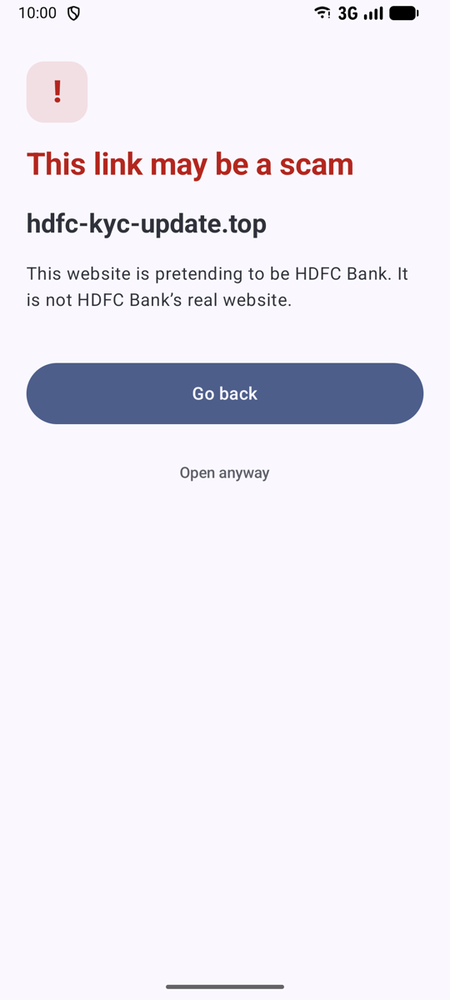
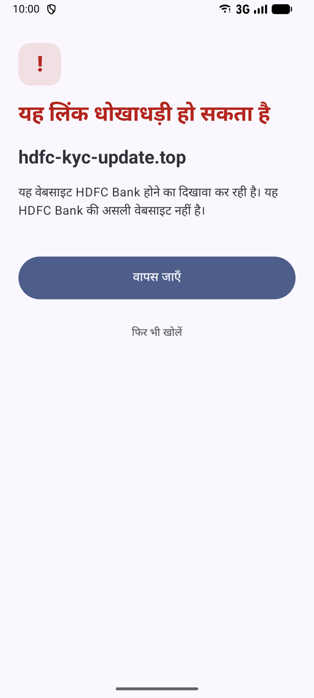
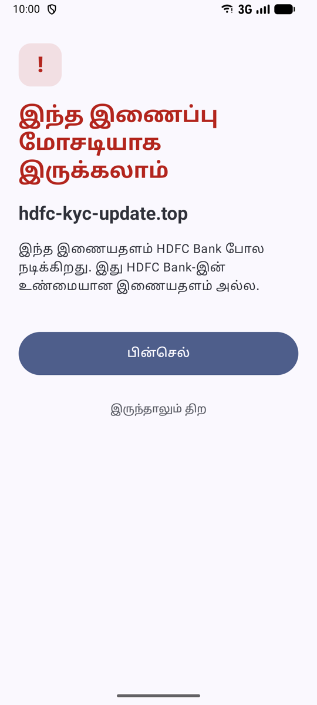
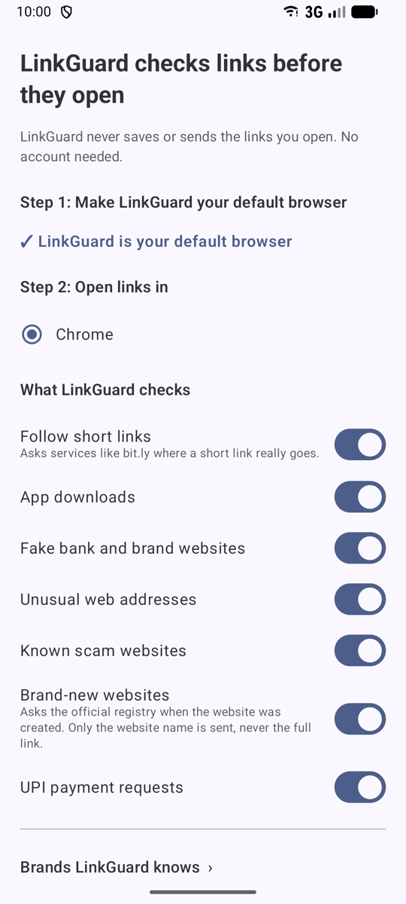

# LinkGuard

LinkGuard is an open-source Android app that sits between the links you tap in WhatsApp, Telegram or SMS and your real browser.
It checks each link on your phone in a fraction of a second. Safe links open straight away and you see nothing.
If a link looks like a scam, you get one plain-language warning in English, Hindi or Tamil. LinkGuard never blocks: you can always choose "Open anyway".

<p>
  
  
  
  
</p>

## What it catches
Fake bank and brand websites (SBI, HDFC, PhonePe, Paytm, India Post, IRCTC and more, including look-alike letters and typos), app downloads from outside the Play Store, UPI payment requests hidden behind links, raw-IP and throwaway addresses, brand-new websites, and known scam sites. Short links (bit.ly and others) are followed first so the real destination is checked.

## Install
> **v0.2.0 is a pre-release.** Hindi and Tamil text is awaiting native review, the scam blocklist is still small, and community warnings need reports from several people before they appear.

1. Download `linkguard-0.2.0-foss.apk` from [Releases](https://github.com/dwarpallabs/linkguard/releases).
2. Open it and allow "Install unknown apps" when Android asks.
3. Open LinkGuard and tap **Set as default browser**. Pick the browser links should open in (Chrome is preselected).

Android 8 or newer. Using Telegram? Turn off its in-app browser (Settings → Chat Settings → In-app browser) so LinkGuard can see links.

## Privacy
LinkGuard never logs, stores or sends the links you open. No accounts, no ads, no analytics, no trackers. Most checks run entirely on your phone. It goes online only to:
- ask a link shortener (bit.ly, t.co, …) where a short link leads; that service would see the same request if you opened the link anyway;
- ask a domain registry when a website was registered, sending only the domain name (`example.com`), never the full link;
- ask the LinkGuard server whether a website is a known scam, sending only a 4-byte fingerprint of the website's name, so the server cannot tell which site you opened;
- download the list of known-safe websites (as fingerprints, signed by Dwarpal Labs);
- send a report, only when you tap **Send report**. Reports are tied to an anonymous, per-website token, so your reports can't be linked together or traced back to you.

Full policy: [dwarpallabs.com/linkguard/privacy](https://dwarpallabs.com/linkguard/privacy).

## Report a scam link
In the app: Settings → **Report a link**. Reports go privately to Dwarpal Labs and are never published. When three or more different people report the same website within a week, other LinkGuard users automatically see a soft warning: "reported as a scam by N LinkGuard users this week". Reports alone never cause the strong red warning, and well-known sites can't be reported into a warning.

## Data sources
- Malware hosts: [URLhaus](https://urlhaus.abuse.ch) by abuse.ch, used under its fair-use terms for not-for-profit projects.
- Popular sites for the safe list: the [Tranco](https://tranco-list.eu) research ranking (Le Pochat et al., NDSS 2019).
- Community reports from LinkGuard users.

## Where the lists live
The scam blocklist and the safe-site allowlist are kept in the LinkGuard server database, not in this repository, so scammers cannot read them. Phones check the blocklist by 4-byte hash prefix and receive the allowlist as signed hashes. The detection rules (look-alike brands, app downloads, unusual addresses, UPI requests) are all here in the open.

## Build from source
Needs JDK 17+ (Android Studio's bundled JBR works).
```
./gradlew :core:test                 # engine + corpus tests (offline)
./gradlew :app:assembleFossRelease   # unsigned unless signing properties are in ~/.gradle/gradle.properties
```
`core/` is pure Kotlin with no Android imports; `corpus/` holds the must-block / must-pass test URLs; `data/` holds the bundled lists. See [CLAUDE.md](CLAUDE.md) for the rules every change follows.

## Verifying the APK
Release APKs are signed by Dwarpal Labs. Signing certificate SHA-256:
```
3b7a7bc8b029e60667a269c9298067f64922f79ec6e8e1ebbf69569795405cee
```
Check with `apksigner verify --print-certs linkguard-0.2.0-foss.apk`.

## License
[Apache-2.0](LICENSE). Bundles the [Public Suffix List](https://publicsuffix.org) (MPL-2.0) and IANA's RDAP bootstrap data.
